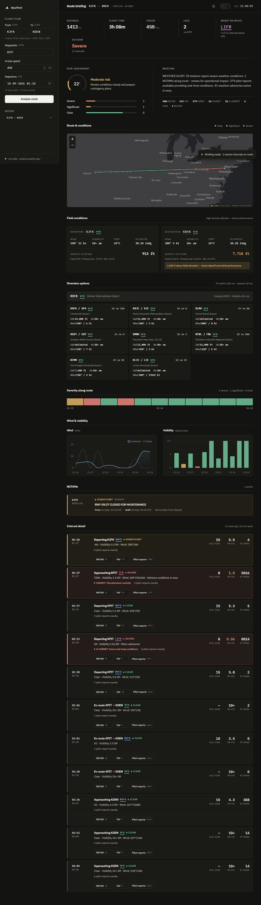
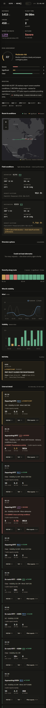

# NavPort

A flight weather dashboard for pilots and aviation planners. Enter a route,
and NavPort pulls live METARs, TAFs, PIREPs, SIGMETs, G-AIRMETs and CWAs
along the flight path, builds a 15-minute interval timeline, and produces a
plain-English briefing with an automated risk assessment.

NavPort is two services:

- **the API** (`backend/`) — a Flask REST API that gathers and analyses the
  weather, packaged as a Docker image and hosted on **Azure Container Apps**;
- **the dashboard** (`frontend/`) — a static web app that calls that API,
  hosted on **Azure Static Web Apps**.

They are built, tested and deployed independently, each by its own GitHub
Actions workflow.

## How to Run

There are two ways. **Python** is for developing on your laptop. **Docker**
runs the same two services as two containers, with production settings — the
shape that gets hosted on Azure. Hosting steps are in
[docs/DEPLOYMENT.md](docs/DEPLOYMENT.md).

### Local development (Python)

| Platform | Double-click |
|---|---|
| Windows | **[`run.bat`](run.bat)** |
| macOS / Linux | **[`run.command`](run.command)** |

Either one will:

1. Check that Python 3.9+ is installed (and tell you where to get it if not).
2. Create a virtual environment in `.venv/` — skipped if one already exists.
3. Install the API's dependencies from `backend/requirements.txt` — skipped if
   they're already up to date.
4. Start both services and print where to open them:
   - the dashboard on **http://localhost:8080**
   - the API on **http://localhost:8000** (its debugger, auto-reload and LAN
     access are opted into explicitly; production defaults stay safe)

Ctrl+C stops both. Re-running is always safe after a `git pull`. On macOS, if
double-clicking opens a text editor, run `chmod +x run.command` once, or
`./run.command`.

Manual equivalent:

```bash
python -m venv .venv
# Windows: .venv\Scripts\activate
# macOS / Linux: source .venv/bin/activate
pip install -r backend/requirements.txt
NAVPORT_ENV=development python scripts/dev.py
```

### Both services in Docker

Install [Docker Desktop](https://www.docker.com/products/docker-desktop/),
then from this folder:

```bash
docker compose up --build
```

Two containers start:

| Container | Serves | Open |
|---|---|---|
| `navport-frontend` | the dashboard, via nginx | **http://localhost:8080** |
| `navport-backend` | the API, via gunicorn | **http://localhost:8000/api/v1/health** |

The backend runs in production mode, so the dashboard reaches it only because
`docker-compose.yml` names the dashboard's origin in `NAVPORT_CORS_ORIGINS` —
the same setting the Azure deployment needs. The backend is capped at
0.5 CPU / 1 GB, the size of a free Azure Container Apps replica, so an
out-of-memory problem shows up here rather than in the cloud.

## Documentation Hub

| Doc | What's in it |
|---|---|
| [docs/DEPLOYMENT.md](docs/DEPLOYMENT.md) | **Start here for hosting.** Docker Hub, Azure Container Apps, Azure Static Web Apps, GitHub Actions, and why it all costs nothing |
| [docs/ARCHITECTURE.md](docs/ARCHITECTURE.md) | Request flow, the two services and how they talk, module map, design rationale |
| [docs/SECURITY.md](docs/SECURITY.md) | Issues found while hardening, what fixed them, known limitations |
| [desktop/README.md](desktop/README.md) | Optional: Tauri installers that call the hosted API |
| This README | Running it, features, the API, layout |

## What You Get

| Capability | Details |
|---|---|
| **Airport identity** | Every ICAO code resolves to its IATA code, airport name, city and country — 34,000 airports worldwide, bundled offline. Hover any code to roll down its meaning |
| **Density altitude** | Pressure and density altitude at both ends, flagged when it runs more than 2,000 ft above field elevation — a standard FAA briefing element |
| **Flight categories** | Standard FAA **VFR / MVFR / IFR / LIFR** for every interval, derived from ceiling and visibility — the language pilots actually plan in |
| **Diversion planning** | Nearby airports that are usable alternates for your destination, ranked by distance with ceiling, visibility, wind and bearing |
| **Route weather timeline** | 15-minute interval breakdown of the whole route, with severity (Clear / Significant / Severe) per segment |
| **Live aviation data** | METAR, TAF, PIREP, SIGMET, G-AIRMET, CWA — fetched concurrently from aviationweather.gov |
| **NOTAMs** | Time-appropriate NOTAM cards per airport (see [Data Sources](#data-sources) — currently simulated demo data) |
| **Risk assessment** | Automated LOW / MODERATE / HIGH risk score with a recommendation, derived from the timeline |
| **Plain-English briefing** | METAR/route conditions summarized in natural language (regex-based NLP, no external LLM call) |
| **Pilot reports (PIREPs)** | Per-station PIREP lookup in a modal, toggle between a decoded summary and the raw report text |
| **Raw data on demand** | Show/hide the raw METAR and TAF text behind any timeline interval without leaving the page |
| **Route map** | Live map with the flight path drawn segment-by-segment in its severity colour, airport markers and per-interval condition popups |
| **Severity ribbon** | Scrubbable strip of the entire route — hover to highlight, click to jump to that interval |
| **Charts** | Wind (sustained + gusts) and visibility, colour-banded by aviation minimums |
| **Printable briefing** | Print or save the whole briefing as a PDF, laid out as a document with a header and no page-split rows |
| **Recent routes** | The last five routes you analysed, one click to re-run |
| **Responsive dashboard UI** | Split-flap display, light and dark themes, animated risk gauge, skeleton loading states, off-canvas flight plan on mobile |

## Architecture at a Glance

```
 Browser
   │  loads the page                          │  calls the API (CORS)
   ▼                                          ▼
 Dashboard — frontend/                      API — backend/
 Azure Static Web Apps                      Azure Container Apps (Docker)
 static HTML / CSS / ES modules             Flask + gunicorn, REST/JSON
                                              │  ~7 concurrent calls per briefing
                                              ▼
                                   aviationweather.gov/api/data
                            (METAR · TAF · PIREP · SIGMET · G-AIRMET · CWA)
```

The dashboard and the API are on different origins, so every call the
dashboard makes is a cross-origin request that the API has to allow by name.
Full request flow, module responsibilities and design rationale are in
[docs/ARCHITECTURE.md](docs/ARCHITECTURE.md).

## Repository Layout

```
NavPort/
├── backend/                       # The API — its own Docker image
│   ├── navport/                   # The Python package
│   │   ├── __init__.py            # App factory: CORS, security, routes
│   │   ├── config.py              # Settings, production-safe defaults
│   │   ├── security.py            # Headers, rate limiting, gzip, error handling
│   │   ├── validation.py          # Input validation — bad input is 4xx, not 500
│   │   ├── cache.py               # TTL cache for upstream weather calls
│   │   ├── telemetry.py           # Live console device/traffic reporting (dev)
│   │   ├── models/pirep.py        # PIREP dataclass + raw-text parsing
│   │   ├── services/              # flight_rules · pirep · nlp · weather · airports
│   │   ├── routes/                # /api/v1 blueprints · meta · deprecated /api aliases
│   │   ├── openapi.py             # The OpenAPI 3.1 contract, served at /api/v1/openapi.json
│   │   ├── problems.py            # RFC 9457 Problem Details error responses
│   │   └── data/airports.json.gz  # 34,000 airports, bundled
│   ├── tests/
│   │   ├── api_test.py            # End-to-end against a running API
│   │   └── test_risk.py           # Risk scoring logic, no server needed
│   ├── wsgi.py                    # WSGI entry: gunicorn imports it, or run it for the dev server
│   ├── gunicorn.conf.py           # Production server settings
│   ├── requirements.txt
│   └── Dockerfile                 # Two-stage, non-root, gunicorn on :8000
├── frontend/                      # The dashboard
│   ├── public/                    # Everything that gets served, as-is (no build step)
│   │   ├── index.html
│   │   ├── staticwebapp.config.json  # Security headers, MIME types, cache rules
│   │   ├── manifest.webmanifest   # PWA install metadata
│   │   ├── sw.js                  # Service worker — shell cached, weather never
│   │   ├── offline.html
│   │   ├── css/                   # tokens · layout · components · dashboard · platform · print · board
│   │   ├── js/
│   │   │   ├── main.js            # ES module entry point
│   │   │   ├── api-config.js      # Where the API is — rewritten per deployment
│   │   │   ├── config.js          # Resolves the API base URL
│   │   │   ├── native.js          # Native-shell detection, runs before first paint
│   │   │   ├── core/              # api · state · dom · format · idents
│   │   │   ├── ui/                # shell · theme · recent · toast · offline · board
│   │   │   └── views/             # overview · risk · ribbon · map · charts · notams · timeline · alternates · pireps
│   │   ├── docs/                  # API reference page (Swagger UI over the API's own openapi.json)
│   │   ├── vendor/                # Leaflet, Chart.js, Swagger UI, IBM Plex — served from our own origin
│   │   └── assets/                # icon.png + generated icon set
│   ├── tools/site.py              # Dev server · nginx config · per-deployment API address
│   ├── tests/site_test.py         # End-to-end against any served copy, including production
│   ├── Dockerfile                 # nginx, non-root — for docker compose only
│   └── nginx.conf
├── desktop/                       # Optional Tauri shells (Windows, macOS, Linux, Android, iOS)
├── scripts/
│   ├── dev.py                     # Runs the dashboard and the API together (run.bat uses it)
│   ├── vendor_assets.py           # Fetch + hash-verify frontend/public/vendor/
│   ├── ui_matrix.py               # Render at 7 form factors, audit the layout
│   ├── build_icons.py             # Generate every icon size from icon.png
│   ├── build_airport_db.py        # Rebuild the bundled airport database
│   └── check_tauri_config.py      # Validate tauri.conf.json against the v2 schema
├── docker-compose.yml             # Both containers, production settings
├── run.bat / run.command          # One-click launchers
├── pyproject.toml                 # Ruff config
├── .github/workflows/             # ci · backend (Docker Hub → Container Apps) · frontend (Static Web Apps) · apps
└── docs/                          # ARCHITECTURE · DEPLOYMENT · SECURITY · screenshots
```

## API Endpoints

A versioned REST API under **`/api/v1`**. The full contract is an OpenAPI 3.1
document the API serves about itself, `GET /api/v1/openapi.json`, and the
dashboard renders it as an interactive reference at **`/docs/`** — every
endpoint below can be called from that page.

| Method | Path | Purpose |
|---|---|---|
| `GET` | `/api/v1` | Index: what the service is and a link to every resource |
| `GET` | `/api/v1/health` | Liveness and readiness. Docker and Azure probe this; never rate limited |
| `GET` | `/api/v1/openapi.json` | The contract, as OpenAPI 3.1 |
| `GET` | `/api/v1/airports?codes=KJFK,EGLL` | Look up several airports at once |
| `GET` | `/api/v1/airports/{icao}` | One airport, with links to its alternates and pilot reports |
| `GET` | `/api/v1/airports/{icao}/alternates` | Usable diversions nearby, best first (`?radius=`, `?limit=`, `?runway=`) |
| `GET` | `/api/v1/airports/{icao}/pireps` | Pilot reports near the airport (`?distance=`, `?age=`, `?raw=`) |
| `POST` | `/api/v1/briefings` | Brief a flight plan: weather timeline, NOTAMs, risk, plain-English summary |
| `POST` | `/api/v1/flight-plans/parse` | Turn free text ("KJFK to KLAX via KORD") into a flight plan |

**How it follows REST.** URLs name resources — nouns, plural for collections,
nested where one belongs to another (an airport's alternates). The HTTP method
is the verb: `GET` reads and is safe to repeat, `POST` sends data to be
processed. Status codes carry the outcome: `200`, `400` invalid input, `404` no
such resource, `405` wrong method (with an `Allow` header), `413` body too
large, `429` rate limited (with `Retry-After`), `503` upstream weather
unavailable. Every error body is an [RFC 9457](https://www.rfc-editor.org/rfc/rfc9457)
Problem Details document (`application/problem+json`) with the same fields, so
a client handles every failure one way. The API is stateless — no sessions, any
replica can answer any request — and responses say whether they may be cached
(an airport for a day; weather never). The index and each airport carry
`links` to related resources, so a client can follow them instead of building
URLs. `/api/v1/flight-plans/parse` is the one *controller* resource: an action
rather than a thing, so its name ends in a verb.

**Versioning.** The original endpoints (`/api/health`,
`/api/enhanced-flight-plan`, `/api/pirep-reports/…` and so on) still answer,
running the same code, so nothing written against them broke. Each response
from them says it is deprecated (`Deprecation`), when it may stop working
(`Sunset`) and where its replacement is (`Link: <…>; rel="successor-version"`).
The full mapping is in `backend/navport/routes/legacy_routes.py`.

## Technology Stack

**API:** Flask, `requests`, `concurrent.futures` for parallel upstream calls,
regex-based NLP and a pure-Python flight-rules engine — no external ML/LLM
dependency, nothing beyond `backend/requirements.txt`. Served by gunicorn in a
Docker image.

**Dashboard:** Native ES modules — no bundler, no build step, no framework
runtime. Chart.js for the wind/visibility plots, Leaflet for the route map,
IBM Plex Sans + IBM Plex Mono for type. All three are committed under
`frontend/public/vendor/` and served from the dashboard's own origin rather
than a CDN, so a bad minute at a CDN cannot leave the page with no map, and the
packaged apps open without a network. Light and dark themes driven entirely by
CSS custom properties.

**Hosting:** Azure Container Apps (API), Azure Static Web Apps (dashboard),
Docker Hub (the API's image), GitHub Actions (CI/CD).

**Data:** [Aviation Weather Center](https://aviationweather.gov) public API for
weather; [OurAirports](https://ourairports.com/data/) (public domain) for the
bundled worldwide airport database.

## Data Sources

- **Live weather** (METAR/TAF/PIREP/SIGMET/G-AIRMET/CWA/station info): real
  data from aviationweather.gov, up to 15 days historical and a few hours of
  forecast, depending on product.
- **NOTAMs**: currently deterministic demo data (see
  [docs/ARCHITECTURE.md §6](docs/ARCHITECTURE.md#6-notams-are-simulated)) —
  real NOTAM feeds require an authenticated/paid API (FAA NOTAM Search, SWIM,
  or a commercial provider). Every generated NOTAM is labeled
  `"source": "Demo Data (Time-Based)"` in API responses so this is never
  mistaken for live data.
- **Weather outside the API's real-time window** is deterministically
  simulated from the nearest real observation so the full route timeline can
  still be rendered.

## Configuration

The API reads these environment variables, all optional, in
`backend/navport/config.py`. Every default is the safe one: with nothing set,
the API runs as though it were in production, so forgetting a variable can
never be what exposes the debugger. `run.bat` and `run.command` are the only
things that opt into development mode, and they do it explicitly.

| Variable | Default | Purpose |
|---|---|---|
| `NAVPORT_ENV` | `production` | `development` relaxes the defaults below |
| `NAVPORT_HOST` | `0.0.0.0` in production, `127.0.0.1` otherwise | Bind address |
| `PORT` / `NAVPORT_PORT` | `8000` | Port. `PORT` wins — it is what Azure and most hosts set |
| `NAVPORT_DEBUG` | `false` | Flask debug/reload. Ignored unless `NAVPORT_ENV` is development, because the debugger is remote code execution |
| `NAVPORT_CORS_ORIGINS` | — | Comma-separated origins allowed to call the API. **Must include the dashboard's address** (the Static Web App URL in production). The native-shell origins are always allowed; everything is allowed in development |
| `NAVPORT_RATE_LIMIT` | `60` | Requests per window, per IP |
| `NAVPORT_BRIEFING_RATE_LIMIT` | `10` | Briefings per window, per IP — this is the endpoint that fans out to the upstream API |
| `NAVPORT_RATE_WINDOW` | `60` | Window length in seconds |
| `NAVPORT_TRUST_PROXY` | on in production | Read the client IP from `X-Forwarded-For`. Only correct behind a proxy that overwrites that header — otherwise anyone can spoof their way around the rate limit. Set it to `false` when running the container with no proxy in front |
| `NAVPORT_TELEMETRY` | on in development | Live console device/traffic reporting |
| `NAVPORT_CACHE_WEATHER_TTL` | `300` | Seconds to cache an upstream weather response |
| `NAVPORT_CACHE_STATION_TTL` | `86400` | Seconds to cache station coordinates |
| `NAVPORT_MAX_BODY_BYTES` | `65536` | Request body limit |

Gunicorn has its own knobs (`WEB_CONCURRENCY`, `NAVPORT_THREADS`,
`NAVPORT_TIMEOUT`) documented in `backend/gunicorn.conf.py`.

The dashboard has one setting: the API's address, written into
`frontend/public/js/api-config.js` at deploy time by
`python frontend/tools/site.py configure --api-base <url>`. Locally it
defaults to port 8000 of whichever machine served the page.

## Optional extras

| Extra | How |
|---|---|
| **Home-screen icon** | On a phone, open the dashboard → Add to Home Screen / Install. That is a PWA; weather still comes from the API |
| **Windows / Mac / Android installers** | [desktop/README.md](desktop/README.md). Thin Tauri windows around the same dashboard, calling the same API. Skip App Store / Play |

## Checking It Still Works

```bash
python backend/tests/test_risk.py                         # risk scoring, no server needed
python backend/tests/api_test.py http://127.0.0.1:8000    # every endpoint, CORS, headers, rate limits
python frontend/tests/site_test.py http://127.0.0.1:8080  # the dashboard: headers, CSP, PWA files, compression
python scripts/ui_matrix.py                               # render at 7 form factors and audit the layout
python scripts/vendor_assets.py --check                   # confirm frontend/public/vendor/ matches upstream
ruff check backend/ frontend/tools/ frontend/tests/ scripts/
```

`site_test.py` runs against any address the dashboard is served from — the
local dev server, the nginx container, or the live Static Web App — and the
frontend workflow runs it against production after every deploy.

`ui_matrix.py` drives a headless Chrome or Edge, runs a real briefing at each
size, writes a screenshot to `docs/screenshots/`, and fails on horizontal
overflow, tap targets whose reachable area is under 44px, or form fields small
enough to make iOS Safari zoom on focus. `.github/workflows/ci.yml` runs the
rest on every push, plus a Docker job that builds both images, starts them with
`docker-compose.yml`, asserts neither runs as root, and runs both test suites
against the containers.

The tap-target check hit-tests with `elementFromPoint` rather than measuring
bounding boxes, because several controls are deliberately small on screen and
grown with a transparent `::after` — a box measurement reports those as
failures when they are fine, and reports a control covered by something
stacked on top of it as fine when it is not.

| Desktop, 1280px | Phone, 393px |
|---|---|
|  |  |

## Disclaimer

This application is for informational and educational purposes only. All
weather information should be verified through official aviation weather
sources. Do not use this application as the sole source for flight planning
decisions — always consult official NOTAMs, weather briefings, and follow
applicable aviation regulations.
